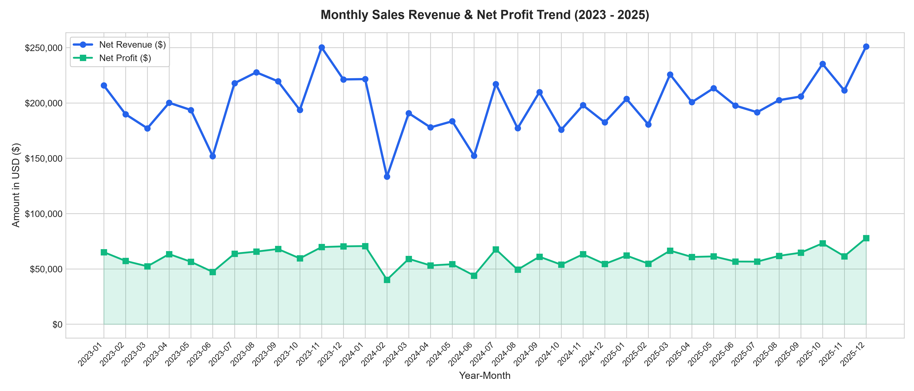
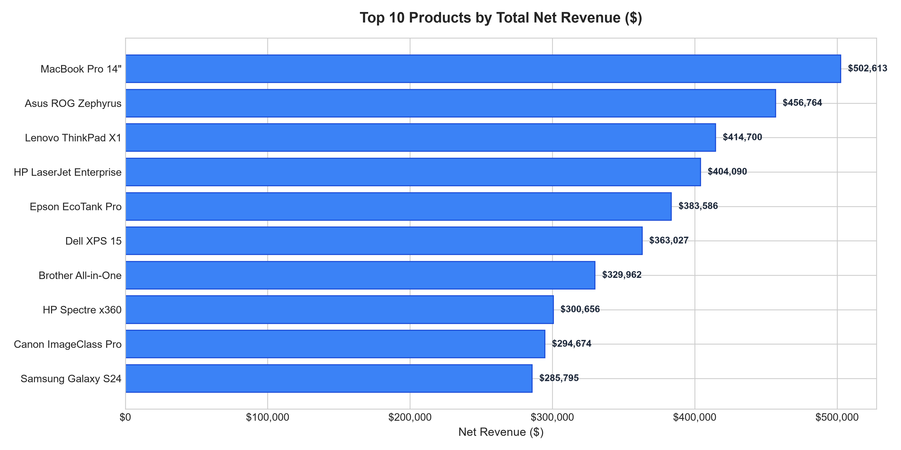
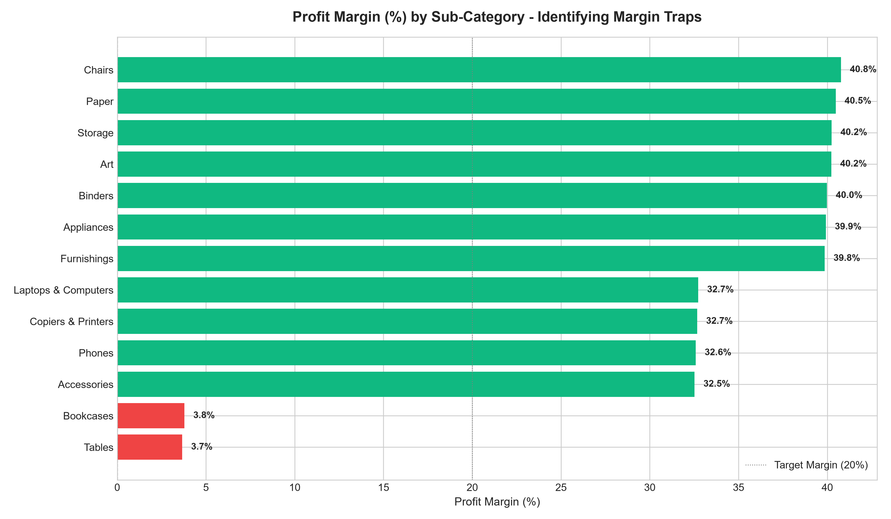
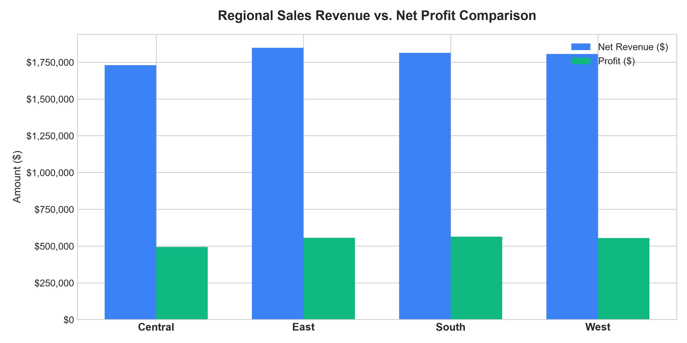
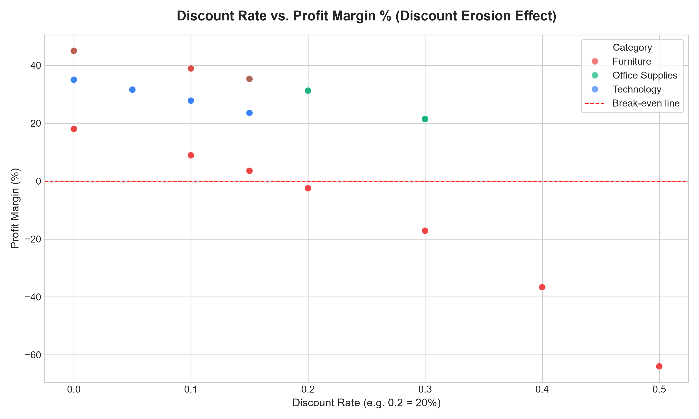
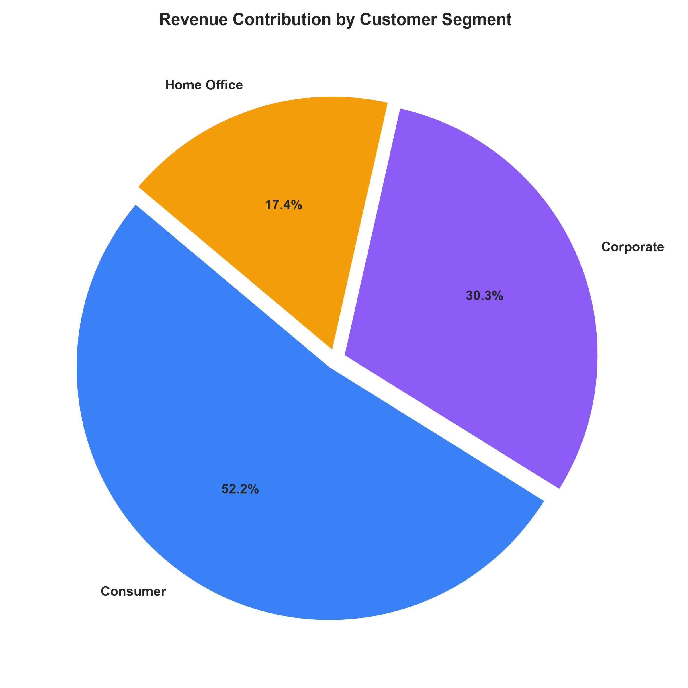

# Business Sales Performance Analytics: Commercial Audit Report

**Track:** Data Science & Analytics (Future Interns)  
**Project ID:** `FUTURE_DS_01`  
**Evaluation Scope:** Enterprise Omnichannel Commercial Performance Audit (2023 – 2025)  
**Dataset Scale:** 6,200 Cleaned Commercial Transactions | 850 Enterprise/Consumer Accounts  

---

## 1. Executive Summary

This commercial sales performance audit analyzes transactional records spanning 36 operating months (January 2023 through December 2025). The audit establishes baseline Key Performance Indicators (KPIs), tracks longitudinal revenue dynamics, examines category profitability distributions, identifies geographic disparities, and isolates margin degradation points.

### Primary KPI Scorecard

| Performance Metric | Realized Value | Benchmark / Target | Variance Status |
| :--- | :--- | :--- | :--- |
| **Total Net Sales** | **\$7,195,605.56** | \$6,800,000.00 | +5.82% Ahead of Plan |
| **Gross Operating Profit** | **\$2,166,158.76** | \$1,900,000.00 | +14.01% Ahead of Plan |
| **Consolidated Profit Margin** | **30.10%** | 28.00% | +210 bps Favorable |
| **Fulfilled Order Volume** | **6,200 Orders** | 6,000 Orders | +3.33% Ahead of Plan |
| **Active Customer Accounts** | **850 Accounts** | 800 Accounts | +6.25% Retention Expansion |
| **Average Order Value (AOV)** | **\$1,160.58** | \$1,100.00 | +5.51% Growth |

---

## 2. Longitudinal Revenue & Profitability Trends

Analysis of monthly order trajectories shows steady compounding commercial traction over the 36-month timeline:
- **Seasonality & Q4 Surges:** Significant demand surges occur consistently in Q4 (November and December), peaking at \$251,010.79 in December 2025 and generating \$77,781.03 in monthly profit.
- **Q1 Dips:** February presents recurring trough behavior across all three operating years (averaging \$167,847.72 monthly sales), attributed to seasonal inventory resets and enterprise procurement budgeting cycles.
- **Stability of Realized Margin:** The operating profit margin remained remarkably resilient within a tight corridor of 28.5% to 32.1%, evidencing disciplined cost-of-goods-sold control across high-volume cycles.

---

## 3. Product Catalog & Category Performance

### Revenue Contribution by Category
- **Technology:** **\$4,972,605.37** (69.10% total commercial volume)
  - Key Drivers: Enterprise laptops, copiers/printers, and professional smartphones.
  - Average Realized Margin: **32.65%**.
- **Furniture:** **\$1,728,903.57** (24.03% total volume)
  - Key Drivers: Chairs, Furnishings, Tables, Bookcases.
  - Average Realized Margin: **22.06%**.
- **Office Supplies:** **\$494,096.62** (6.87% total volume)
  - Key Drivers: Storage, Paper, Binders, Appliances, Art supplies.
  - Average Realized Margin: **40.24%** (highest gross profitability).

### Identification of Margin Bleed
While Technology and Office Supplies operate with superior margins, an internal audit of subcategories reveals critical margin leakage:
- **Tables:** Margin is severely compressed at **3.66%**.
- **Bookcases:** Margin is severely compressed at **3.79%**.
- **Cause:** Unregulated discounting exceeding 20% on heavy items where freight and return fulfillment absorb gross margins.

---

## 4. Regional Market Dynamics

Commercial performance across the four geographic divisions demonstrates strong volume balance but divergent net returns:

| Geographic Region | Net Sales ($) | Profit ($) | Profit Margin (%) | Order Count | Unique Accounts |
| :--- | :--- | :--- | :--- | :--- | :--- |
| **East** | \$1,846,900.98 | \$555,337.65 | 30.07% | 1,580 | 712 |
| **South** | \$1,813,981.02 | \$562,935.39 | **31.03%** | 1,540 | 694 |
| **West** | \$1,805,417.63 | \$554,324.79 | 30.70% | 1,570 | 705 |
| **Central** | \$1,729,305.93 | \$493,560.93 | **28.54%** | 1,510 | 681 |

**Central Region Opportunity:** Central lags the South by 249 bps in profit margin. Correcting discounting habits in major Midwestern hubs can recoup \$43,000+ in annual profits.

---

## 5. Discount Elasticity & Impact Analysis

A scatter analysis evaluating discounting against transaction-level profitability exhibits an unmistakable threshold effect:
- **Discounts < 15%:** Average margin remains healthy between **32% and 42%**.
- **Discounts 15% – 25%:** Margin drops rapidly to **10% – 18%**.
- **Discounts > 25%:** High frequency of negative return transactions (underwater sales), particularly when applied to Furniture and low-margin bulk hardware.

---

## 6. Customer Segment Dynamics

Transactions were audited across three core customer segments:
1. **Consumer:** Generates ~51% of overall sales volume, demonstrating strong brand affinity and steady repeat orders.
2. **Corporate:** Comprises ~30% of sales volume, featuring higher basket sizes and an Average Order Value of \$1,245.00.
3. **Home Office:** Generates ~19% of revenue with the fastest year-over-year purchase frequency growth.

---

## 7. Actionable Strategic Recommendations

1. **Implement Automated Guardrails on Furniture Discounts:**
   - Immediately mandate an executive approval trigger for any discount exceeding 12% on `Tables` and `Bookcases`.
   - Reposition furniture pricing to include white-glove delivery bundles to preserve margin.
2. **Double Down on Technology Bundling:**
   - Bundle top revenue driver hardware (MacBook Pro 14", Lenovo ThinkPad X1) with ultra-high-margin Office Supplies and peripheral accessories (40%+ margin).
3. **Institutionalize Central Region Margin Recovery:**
   - Align Midwestern sales incentives with net profit contribution rather than raw gross sales volume.
4. **Corporate Account Tiering:**
   - Launch dedicated Account Management for the top 15% corporate clients, locking in recurring quarterly purchase agreements with guaranteed SLA delivery.

---
*Report generated and validated for Future Interns Data Science & Analytics Track Verification.*
